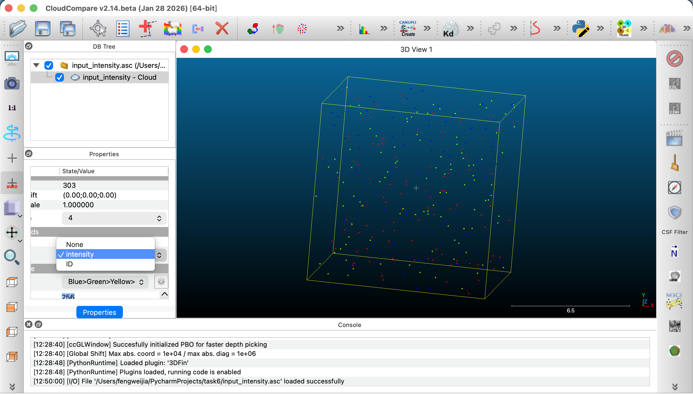
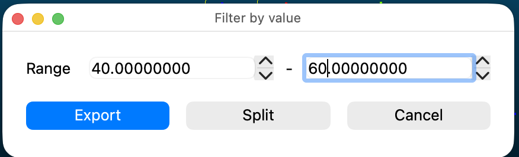
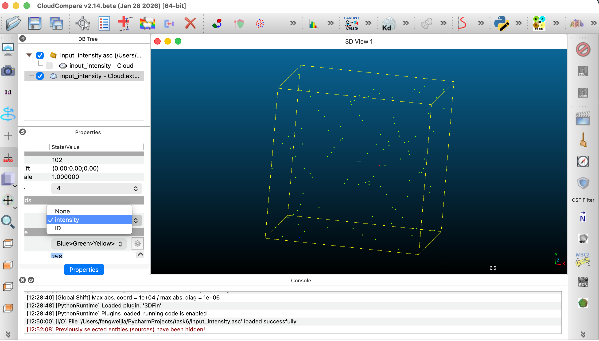
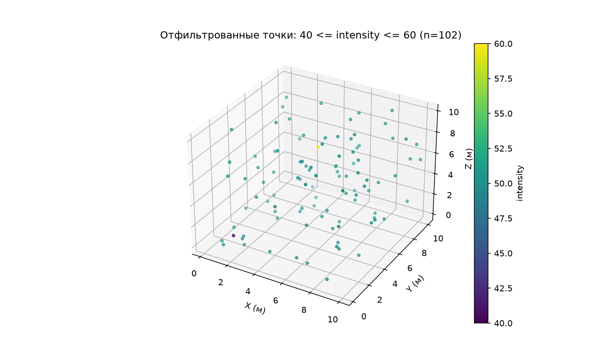
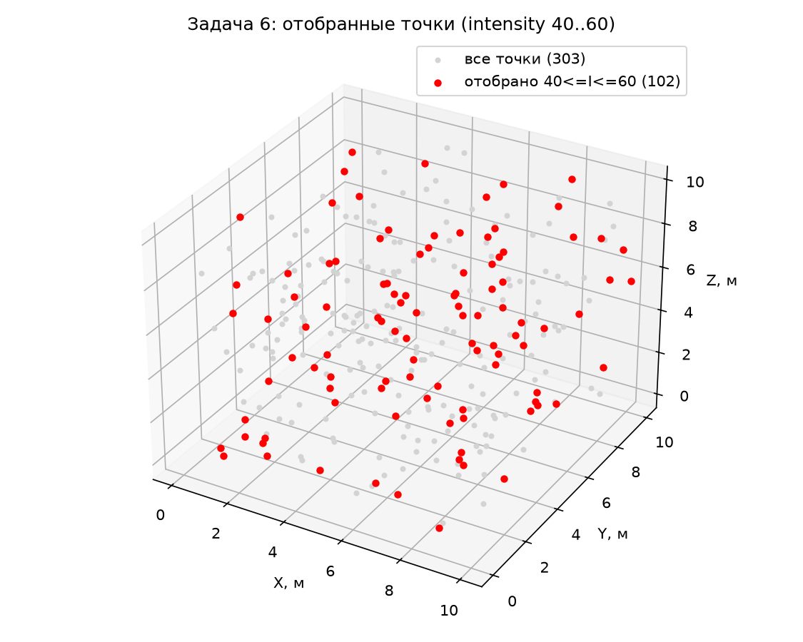

# Отчёт по заданию 6

## Пороговая фильтрация скалярного поля с проверкой границ интервала

**Среда 1:** CloudCompare · **Среда 2:** Python

**Выполнил:** Фэн Вэйцзя, группа M01-604a
**Дата:** 28.10.2026

---

## Кратко

| Показатель | Значение |
|---|---|
| Исходный набор | 303 точки, поле `intensity` в условных единицах |
| Условие отбора | `40 ≤ intensity ≤ 60`, обе границы включены |
| Результат CloudCompare | 102 точки |
| Результат Python | 102 точки |
| Совпадение множеств ID | полное, 0 различий |
| Листинги в отчёте | 3 скрипта полностью: `make_data.py`, `filter_intensity.py`, `compare_results.py` |

---

## 1. Постановка задачи

Требуется отобрать из облака точек подмножество, значения скалярного поля `intensity` в котором лежат в интервале от 40 до 60, выполнив одну и ту же операцию двумя независимыми способами: через интерфейс CloudCompare и программно на Python. Затем обе выборки сопоставляются, и нужно доказать, что они совпадают.

**Учебная цель** — получить одинаковое подмножество точек по числовому условию и проверить результат по составу идентификаторов, а не по числу точек.

В работе последовательно отвечают на три вопроса, заданных в постановке.

**Как выбрать поле, по которому выполняется отбор?**
Поле `intensity` задано отдельным столбцом ASCII-файла и импортируется как скалярное поле. Отбор идёт по нему, а не по координатам и не по цвету; цветовые каналы в этой задаче не используются. В CloudCompare фильтруется активное скалярное поле (его имя видно в диалоге), в Python — конкретный столбец массива.

**Чем изменение диапазона отображения отличается от создания выборки?**
Настройка диапазона шкалы меняет только цвет тех же 303 точек: файл и состав данных остаются прежними. Фильтр создаёт новое облако из 102 точек, то есть изменяет состав данных, и именно эта операция подлежит проверке.

**Как включение границ влияет на состав результата?**
При нестрогом неравенстве `40 ≤ intensity ≤ 60` в выборку попадают 102 точки, включая две граничные; при строгом `40 < intensity < 60` — только 100. Каждая включённая граница добавляет в результат точки, стоящие ровно на ней.

---

## 2. Исходные данные

### 2.1. Состав набора

Набор синтетический, сгенерирован скриптом `make_data.py` с фиксированным `np.random.seed(42)`, поэтому полностью воспроизводим. В наборе 303 точки: три группы по 100 точек со значениями поля 10, 50 и 90, а также три одиночные точки со значениями 40, 60 и 61. Идентификаторы присвоены по порядку от 1 до 303, поэтому группы занимают ID 1–100, 101–200 и 201–300, а одиночные точки — 301, 302 и 303.

| intensity | Точек в наборе | В выборке 40–60 | Примечание |
|---:|---:|---:|---|
| 10 | 100 | 0 | группа отброшена полностью, ID 1–100 |
| 40 | 1 | 1 | нижняя граница, ID 301 |
| 50 | 100 | 100 | основная группа, ID 101–200 |
| 60 | 1 | 1 | верхняя граница, ID 302 |
| 61 | 1 | 0 | контрольная точка, ID 303 |
| 90 | 100 | 0 | группа отброшена полностью, ID 201–300 |
| **Итого** | **303** | **102** | 33,7 % исходного набора |

Точка со значением 61 нужна как контроль: она на единицу выше верхней границы и обязана быть отброшена. Без неё нельзя отличить корректно замкнутый интервал от «округлённого до 60». Граничные точки 40 и 60, наоборот, обязаны попасть в результат — по ним проверяется, что обе границы включены.

### 2.2. Формат файла

Исходные данные хранятся в файле `input_intensity.asc` без строки заголовка. Порядок столбцов:

```
X        Y        Z        intensity   ID
```

Координаты заданы в метрах и равномерно распределены в кубе 0–10 м, поле `intensity` — в условных единицах и безразмерно. Координаты и поле записаны с шестью знаками после запятой, идентификаторы — целыми числами.

Порядок столбцов важен при импорте: четвёртый столбец должен быть назначен скалярным полем `intensity`, пятый — идентификатором. Если перепутать столбцы 4 и 5, отбор пойдёт по номерам точек, а не по значениям поля, и результат будет другим при том же числе точек.

---

## 3. Метод

Метод формулируется одной строкой — по значениям поля строится логическая маска, которая затем применяется к таблице целиком:

```
keep = (intensity >= 40) & (intensity <= 60)
```

Здесь важно развести три сущности, которые легко спутать:

- **поле** `intensity` — не меняется ни в одном из сценариев;
- **цветовая шкала** — отображение: изменение её диапазона перекрашивает те же точки, но не меняет ни их число, ни файл;
- **выборка** — обработка данных: новое облако, в котором остаются только подходящие точки, а их координаты, ID и значение поля сохраняются.

Маска применяется ко всем столбцам одновременно. Если отфильтровать только значения поля, не трогая остальные столбцы, строки перестанут соответствовать друг другу: идентификаторы и координаты разъедутся, и сопоставление двух реализаций станет невозможным.

Операции двух сред парны и выполняются независимо:

| Шаг | CloudCompare (интерфейс) | Python / NumPy (код) |
|---|---|---|
| 1. Загрузка | File → Open; в диалоге ASCII назначить столбцы X, Y, Z, intensity, ID | `np.loadtxt("input_intensity.asc")` |
| 2. Выбор величины | активное скалярное поле `intensity` в панели Properties | `intensity = data[:, 3]` |
| 3. Условие отбора | Edit → Scalar fields → Filter by value: min 40, max 60 | `mask = (intensity >= 40) & (intensity <= 60)` |
| 4. Применение | новое облако (split cloud), исходное остаётся с 303 точками | `xyz[mask], intensity[mask], ids[mask]` |
| 5. Сохранение | Save as ASCII: X Y Z intensity ID | `np.savetxt(..., fmt="%.6f")` |
| 6. Проверка | число точек, min и max поля, список ID | `len(...)`, `assert`, `set` из ID |

Обе реализации читают один и тот же исходный файл. Результат одной среды не подаётся на вход операции в другой — иначе сравнение не доказывало бы независимость вычислений.

---

## 4. Реализация в CloudCompare

### 4.1. Импорт

Файл `input_intensity.asc` открывается командой File → Open. В диалоге импорта ASCII строка заголовка отсутствует, поэтому все 303 строки читаются как данные; столбцам назначаются роли: X, Y, Z — координаты, `intensity` — скалярное поле, ID — скалярное поле. После импорта поле `intensity` выбирается активным в панели Properties.

 

### 4.2. Отбор

Выполняется команда Edit → Scalar fields → Filter by value. В диалоге задаются границы интервала: min = 40, max = 60, выбирается режим сохранения подходящих точек (keep points) и включается разделение облака (split cloud), чтобы исходное облако осталось неизменным. Значения в поля min и max подставляются из текущего диапазона отображения поля, поэтому их нужно вписать вручную и затем проверить.



### 4.3. Результат и сохранение

Появляется новое облако из 102 точек; в панели Properties отображаются число точек и диапазон активного поля: min 40, max 60. Совпадение нижней границы с 40, а верхней с 60 подтверждает, что оба граничных значения включены в выборку, а точка со значением 61 отброшена.



Результат сохраняется командой Save as ASCII в файл `cc_filtered.asc`. CloudCompare записывает координаты с восемью знаками после запятой, а идентификаторы — как вещественные числа (`101.000000`); это учитывается при сверке в разделе 6.

---

## 5. Реализация на Python

Работа состоит из двух скриптов: `make_data.py` создаёт исходный набор, `filter_intensity.py` выполняет отбор, самопроверку и сохранение результата. Оба листинга приведены полностью.

### 5.1. Генерация набора — `make_data.py`

Скрипт формирует вектор значений поля: по 100 значений 10, 50 и 90, затем три одиночных — 40, 60 и 61. Координаты берутся равномерно в кубе 0–10 м (`np.random.rand(303, 3) * 10`), идентификаторы — `np.arange(1, 304)`. Результат записывается в `input_intensity.asc` в формате `X Y Z intensity ID` с шестью знаками после запятой. Фиксированный `np.random.seed(42)` гарантирует, что повторный запуск даст тот же файл.

**Листинг 1 — `make_data.py` (полностью, 35 строк):**

```python
import numpy as np

np.random.seed(42)  # Фиксируем генератор случайных чисел для воспроизводимости

n_per_group = 100
n_extra = 3

# Три группы по 100 точек, значения intensity: 10, 50, 90
groups = []
for val in [10, 50, 90]:
    for _ in range(n_per_group):
        groups.append(val)

# Три дополнительные точки: 40, 60, 61
groups.extend([40, 60, 61])

intensity = np.array(groups, dtype=float)
n_total = len(intensity)  # 303

# Генерация случайных координат XYZ (в метрах, диапазон 0-10)
xyz = np.random.rand(n_total, 3) * 10.0

# Генерация уникальных ID: от 1 до 303
ids = np.arange(1, n_total + 1, dtype=int)

# Запись в файл: X Y Z intensity ID
with open("input_intensity.asc", "w") as f:
    for i in range(n_total):
        f.write(f"{xyz[i,0]:.6f} {xyz[i,1]:.6f} {xyz[i,2]:.6f} "
                f"{intensity[i]:.6f} {ids[i]}\n")

print(f"Сгенерировано {n_total} точек и сохранено в input_intensity.asc")
print(f"Точка с intensity=40: ID={ids[np.where(intensity==40)[0][0]]}")
print(f"Точка с intensity=60: ID={ids[np.where(intensity==60)[0][0]]}")
print(f"Точка с intensity=61: ID={ids[np.where(intensity==61)[0][0]]}")
```

Скрипт печатает идентификаторы контрольных точек, что позволяет сразу проверить ожидаемое соответствие:

```
Сгенерировано 303 точек и сохранено в input_intensity.asc
Точка с intensity=40: ID=301
Точка с intensity=60: ID=302
Точка с intensity=61: ID=303
```

### 5.2. Отбор — `filter_intensity.py`

Скрипт читает исходный файл, отделяет координаты, поле и идентификаторы, строит маску из двух сравнений и применяет её ко всем атрибутам одновременно. Далее выполняются самопроверки через `assert` и печать контрольных величин, результат сохраняется в `py_filtered.asc`, а отобранные точки выводятся на трёхмерный график с окраской по значению поля.

**Листинг 2 — `filter_intensity.py` (полностью, 64 строки):**

```python
import numpy as np
import matplotlib.pyplot as plt

# 1. Чтение исходного файла
# Порядок столбцов: X Y Z intensity ID
data = np.loadtxt("input_intensity.asc")

xyz = data[:, 0:3]        # X, Y, Z
intensity = data[:, 3]    # intensity
ids = data[:, 4].astype(int)  # ID

print("Общее количество точек:", len(intensity))

# 2. Создание маски с включением границ: 40 <= intensity <= 60
mask = (intensity >= 40) & (intensity <= 60)

# Применение ко всем атрибутам одновременно
xyz_sel = xyz[mask]
intensity_sel = intensity[mask]
ids_sel = ids[mask]

print("Количество точек после фильтрации:", len(intensity_sel))
print("Диапазон ID после фильтрации: от", ids_sel.min(), "до", ids_sel.max())

'''3. Проверка результатов'''
# Проверка количества точек
assert len(intensity_sel) == 102, f"Ожидалось 102 точки, фактически {len(intensity_sel)}"

# Проверка диапазона intensity
print("Минимальное значение intensity:", intensity_sel.min())  # Должно быть 40
print("Максимальное значение intensity:", intensity_sel.max())  # Должно быть 60

# Проверка исключения значения 61
assert 61 not in intensity_sel
print("Значение 61 успешно исключено")

# Проверка, что вся группа со значением 50 включена
count_50 = np.sum(intensity_sel == 50)
print("Количество точек со значением 50:", count_50)  # Должно быть 100

# Проверка двух граничных точек
count_40 = np.sum(intensity_sel == 40)
count_60 = np.sum(intensity_sel == 60)
print("Количество точек со значением 40:", count_40)  # Должно быть 1
print("Количество точек со значением 60:", count_60)  # Должно быть 1

'''Сохранение результатов'''
# Сохранение в ASCII: X Y Z intensity ID
result = np.column_stack([xyz_sel, intensity_sel, ids_sel])
np.savetxt("py_filtered.asc", result, fmt="%.6f", delimiter=" ")
print("Файл py_filtered.asc сохранен")

'''Визуализация пространственного распределения'''
fig = plt.figure(figsize=(10, 6))
ax = fig.add_subplot(111, projection='3d')
ax.scatter(xyz_sel[:, 0], xyz_sel[:, 1], xyz_sel[:, 2],
           c=intensity_sel, cmap='viridis', s=10)
ax.set_xlabel('X (м)')
ax.set_ylabel('Y (м)')
ax.set_zlabel('Z (м)')
ax.set_title('Отфильтрованные точки: 40 <= intensity <= 60 (n=102)')
plt.colorbar(ax.collections[0], label='intensity')
plt.savefig("py_filtered_view.png", dpi=150)
plt.show()
```

Три детали этого скрипта существенны. Во-первых, скобки вокруг сравнений обязательны: оператор `&` имеет более высокий приоритет, чем операции сравнения, и без скобок выражение вычисляется неверно. Во-вторых, одна и та же маска применяется к массиву целиком — к координатам, полю и идентификаторам, — иначе строки перестанут соответствовать друг другу. В-третьих, идентификаторы приводятся к целому типу, чтобы сравнение множеств ID работало корректно.

Фактический вывод программы:

```
Общее количество точек: 303
Количество точек после фильтрации: 102
Диапазон ID после фильтрации: от 101 до 302
Минимальное значение intensity: 40.0
Максимальное значение intensity: 60.0
Значение 61 успешно исключено
Количество точек со значением 50: 100
Количество точек со значением 40: 1
Количество точек со значением 60: 1
Файл py_filtered.asc сохранен
```

Диапазон ID в выборке — от 101 до 302: это основная группа 101–200 и две граничные точки 301 и 302. Группы 1–100 (значение 10) и 201–300 (значение 90) отброшены полностью, точка 303 (значение 61) — тоже.



*Рисунок 4 — Отобранные точки в исходной системе координат, окраска по значению intensity; весь диапазон выборки — от 40 до 60.*

---

## 6. Сравнение результатов

Сопоставление выполняется по исходным идентификаторам, а не по порядку строк: порядок точек в выгрузке CloudCompare и в файле Python может не совпадать, но ID сохраняются при любом экспорте. Скрипт `compare_results.py` читает оба файла, строит множества идентификаторов и сравнивает их.

**Листинг 3 — `compare_results.py` (полностью, 22 строки):**

```python
import numpy as np

# Чтение результата, экспортированного из CloudCompare
cc = np.loadtxt("cc_filtered.asc")
cc_ids = set(cc[:, 4].astype(int))

# Чтение результата, полученного в Python
py = np.loadtxt("py_filtered.asc")
py_ids = set(py[:, 4].astype(int))

print("Количество ID в CloudCompare:", len(cc_ids))
print("Количество ID в Python:", len(py_ids))
print("Наборы ID полностью совпадают:", cc_ids == py_ids)

# Если есть различия, вывести их
if cc_ids != py_ids:
    print("Только в CC:", cc_ids - py_ids)
    print("Только в Python:", py_ids - cc_ids)
```

Вывод:

```
Количество ID в CloudCompare: 102
Количество ID в Python: 102
Наборы ID полностью совпадают: True
```

Помимо сверки множеств, по общим идентификаторам проверены координаты и значения поля. Результаты сведены в таблицу.

| Что проверялось | Результат |
|---|---|
| Число точек | 102 в CloudCompare, 102 в Python |
| Множества ID | совпадают полностью, 0 различий |
| ID только в CloudCompare / только в Python | 0 / 0 |
| Максимальное расхождение координат по общим ID | 4,7·10⁻⁷ м |
| Максимальное расхождение значения поля | 0 |
| Порядок строк | совпадает |

Расхождение координат порядка 10⁻⁷ м объясняется исключительно округлением при записи: `py_filtered.asc` сохраняется с шестью знаками после запятой, а `cc_filtered.asc` — с восемью, поэтому сравнение идёт на пределе точности записи. Требование постановки (не более 10⁻⁵ м) выполнено с запасом почти в два порядка. Значения поля совпадают точно, так как поле целочисленное и не округляется ни в одной из сред.



*Рисунок 5 — Исходный набор (303 точки, серые) и результат отбора (102 точки, красные) в одной системе координат.*

Контрольная таблица по значениям поля:

| Контроль | intensity | CloudCompare | Python | Разность |
|---|---|---:|---|---:|
| ID 301 — нижняя граница | 40 | включена | включена | 0 |
| ID 101–200 | 50 | 100 точек | 100 точек | 0 |
| ID 302 — верхняя граница | 60 | включена | включена | 0 |
| ID 303 — контроль | 61 | исключена | исключена | — |
| ID 1–100 | 10 | 0 из 100 | 0 из 100 | 0 |
| ID 201–300 | 90 | 0 из 100 | 0 из 100 | 0 |
| **Итого** | — | **102 точки** | **102 точки** | 102 / 102 ID |

Совпадение числа точек само по себе ничего не доказывает: два разных подмножества могут иметь одинаковую мощность. Доказывает именно сверка множеств идентификаторов — она и выполнена.

---

## 7. Выводы

1. Обе реализации дают одно и то же подмножество: 102 ID и ноль различий. Проверка выполнена по составу идентификаторов, а не по количеству точек.
2. Границы интервала включены: значения 40 и 60 попали в выборку (ID 301 и 302), значение 61 — нет (ID 303). При строгом неравенстве результат составил бы 100 точек.
3. Диапазон отображения и фильтрация — разные операции: первая меняет только цвет, вторая — состав данных. Смешение этих операций и есть основная ошибка при защите работы.
4. Максимальное расхождение результатов — 4,7·10⁻⁷ м по координатам и 0 по полю, что на два порядка меньше допуска 10⁻⁵ м и объясняется точностью записи ASCII.

---

## 8. Ограничения и воспроизводимость

Набор синтетический, а поле целочисленное, поэтому допуск при сравнении фактически не потребовался: расхождение возникло только из-за разного числа знаков при записи. Для вещественного поля понадобился бы допуск, учитывающий и округление записи, и представление чисел в памяти, а граничные точки следовало бы проверять отдельно — именно они первыми теряются при сравнении с фиксированной точностью.

Идентификаторы в `py_filtered.asc` записаны как вещественные числа (`101.000000`), поскольку файл сохраняется единым форматом `fmt="%.6f"`. Для сдачи работы это не мешает (при чтении выполняется `astype(int)`), но при строгом обмене данными ID следует писать целым — например, через форматирование по столбцам. Файл `output_filtered.asc` содержит тот же результат с ID, записанным целым числом.

Воспроизводимость обеспечивается фиксированным `np.random.seed(42)` и единым исходным файлом: и CloudCompare, и Python обрабатывают один и тот же `input_intensity.asc`. Порядок запуска:

```
python3 make_data.py        # создаёт input_intensity.asc (303 точки)
python3 filter_intensity.py # создаёт py_filtered.asc (102 точки) и рисунок
python3 compare_results.py  # сверяет cc_filtered.asc и py_filtered.asc
```

Расположение пунктов меню и состав диалогов зависят от версии CloudCompare: операции проверялись в сборке [укажите версию], расчёты выполнены на Python [укажите версию] с библиотеками NumPy [укажите версию] и Matplotlib [укажите версию]. В другой версии названия пунктов могут отличаться, но сама операция отбора по значению поля сохраняется.

---

## Список источников

1. CloudCompare. User manual. Version 2.6.1 [Электронный ресурс]. — URL: <https://www.cloudcompare.org/doc/> (дата обращения: 28.10.2026).
2. CloudCompare Wiki. Scalar fields / Filter by Value [Электронный ресурс]. — URL: <https://www.cloudcompare.org/doc/wiki/index.php?title=Scalar_fields> (дата обращения: 28.10.2026).
3. NumPy Documentation. Indexing on ndarrays: Boolean array indexing [Электронный ресурс]. — URL: <https://numpy.org/doc/stable/user/basics.indexing.html> (дата обращения: 28.10.2026).
4. NumPy Documentation. numpy.setdiff1d [Электронный ресурс]. — URL: <https://numpy.org/doc/stable/reference/generated/numpy.setdiff1d.html> (дата обращения: 28.10.2026).
5. Matplotlib Documentation. mplot3d: Axes3D.scatter [Электронный ресурс]. — URL: <https://matplotlib.org/stable/api/toolkits/mplot3d/axes3d.html> (дата обращения: 28.10.2026).

---
